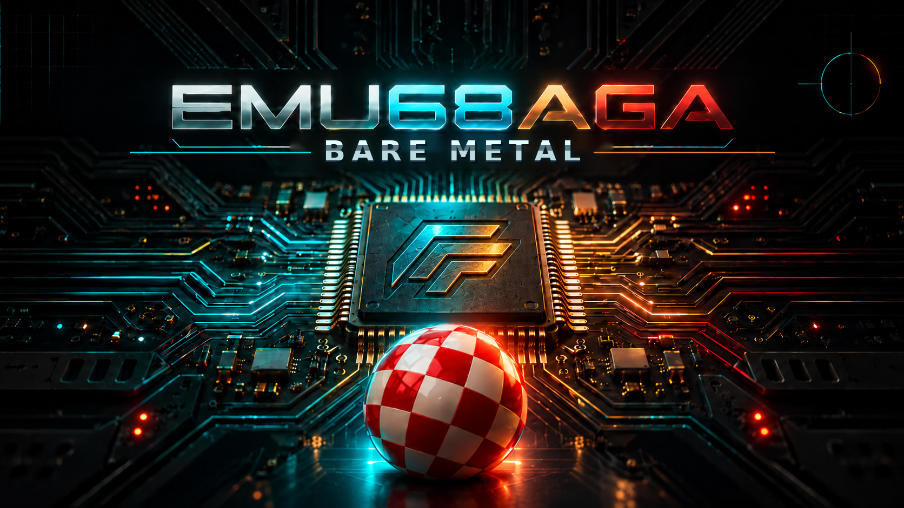

# EMU68AGA BARE METAL AMIGA

**Future Retro Fusion** — standalone, bare-metal Amiga/AGA system for Raspberry Pi 3A+, integrating Emu68 and AGA-PiStorm virtual chipset work. No physical Amiga or PiStorm adapter required.

## What we are doing

PiStorm and AGA-PiStorm have already shown how much of an Amiga can run in software on a Raspberry Pi. In the PiStorm setup, the original Amiga can still be used for native RGB/HAM6 video output and audio playback through Paula.

**EMU68AGA Bare Metal builds on that work to run without an Amiga motherboard or PiStorm adapter.** The Raspberry Pi provides the standalone system, with HDMI for video and sound, USB for input and SD card storage.

Our role is to adapt and integrate the existing emulation for standalone use, and improve compatibility as development continues. Credit for the underlying work belongs to **Emu68, AGA-PiStorm and their contributors**, with further acknowledgements below.

**Current release: EMU68AGA Version 0.1-Alpha (18 October 2026).**
Pi 3 experimental tester build. See [release notes](RELEASE_NOTES_v0.1-alpha.md), [source build instructions](docs/BUILD_v0.1-alpha.md), and the `v0.1-alpha` release tag. The splash footer reads **EMU68AGA Version 0.1-Alpha**. USB input and storage still have known issues; see release notes.

## Start here

- [Installation and AGS 3.1 Classic SD-card guide](docs/INSTALL_AGS31_CLASSIC.md) — complete partition layout, boot files, Kickstart, AGS and troubleshooting.
- [Bare Metal splash and embedded artwork](docs/BARE_METAL_SPLASH.md) — exact source/build instructions.
- [v0.10.25 hardware-tested boot pairing](docs/BOOT_COMBINATION_v0.10.25.md) — exact boot-file provenance, SHA-256 and tests.
- [v0.10.25 ROM-free boot support ZIP](distribution/EMU68AGA_BARE_METAL_v0.10.25_BOOT_SUPPORT_ROM_FREE.zip) — exact v0.10.22 configuration; **does not contain a kernel or Kickstart ROM and is not bootable by itself**.
- [Older public v0.10.23 diagnostic ZIP](distribution/FRF_EMU68AGA_BARE_METAL_PUBLIC_BOOT_ALPHA_v0.10.23.zip) — USB is disabled; not the tested combination.
- [v0.10.25 preparation notes](RELEASE_NOTES_v0.10.25.md)
- [USB integration source](docs/USB_SOURCE.md) — FRF adapter only, not bundled USPi and not a redistributable combined binary.
- [USB redistribution status](USB-LICENSING.md)

The native USB implementation remains under active development. Source-file notices and third-party attribution are preserved.

## Features exercised in local development

- Emu68 68k JIT, virtual AGA graphics (Alice/Lisa/Paula), Copper, blitter and CIA emulation.
- HDMI video and Paula audio, 2 MiB Chip RAM, 512 KiB Ranger memory and Zorro III Fast RAM.
- 32 GB microSD layout with FAT32 boot and Emu68 `0x76` Amiga/AGS partitions and an Emu68 ROM-board/autoconfig path.
- USB keyboard/mouse in the local build, with experimental joypad-to-Amiga-port-2 mapping.
- Amiga soft-reset/autoconfig fixes in v0.10.21; WHDLoad game compatibility still varies by title/demo.

## Project credits and licensing

This is a hobby project, **but non-commercial use does not remove redistribution licence obligations**. FRF credits its own standalone integration to **Future Retro Fusion**, and preserves upstream credits and source-file licences.

Emu68: Michal Schulz and contributors; AGA-PiStorm: Astair86 and contributors; PiStorm: Claude Schwarz and contributors; UAE/WinUAE: their respective contributors. See [THIRD_PARTY_NOTICES.md](THIRD_PARTY_NOTICES.md), [LICENSE-FRF.md](LICENSE-FRF.md), and source headers.

No Kickstart ROM, AmigaOS/AGS software, WHDLoad games or third-party disk images are distributed here.
