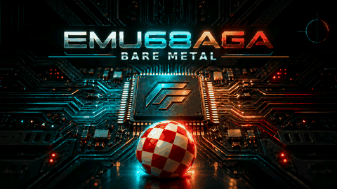

# EMU68AGA BARE METAL AMIGA

**Future Retro Fusion** — standalone, bare-metal Amiga/AGA system for Raspberry Pi 3A+, integrating Emu68 and AGA-PiStorm virtual chipset work. No physical Amiga or PiStorm adapter required.

## What we are doing

PiStorm and AGA-PiStorm have already shown how much of an Amiga can run in software on a Raspberry Pi. In the PiStorm setup, the original Amiga can still be used for native RGB/HAM6 video output and audio playback through Paula.

**EMU68AGA Bare Metal builds on that work to run without an Amiga motherboard or PiStorm adapter.** The Raspberry Pi provides the standalone system, with HDMI for video and sound, USB for input and SD card storage.

Our role is to adapt and integrate the existing emulation for standalone use, and improve compatibility as development continues. Credit for the underlying work belongs to **Emu68, AGA-PiStorm and their contributors**, with further acknowledgements below.

**Current public release: [EMU68AGA Bare Metal v0.10.40a](https://github.com/futureretrofusion/EMU68AGA-Bare-Metal/releases/tag/v0.10.40a) (23 October 2026).**
Hardware-verified Pi 3 USB/HID endian correction, including working gamepad direction and button input. Download the ready-to-copy `kernel8.img` and matching R40a ZIP from that release. The release does not include Kickstart ROM, AmigaOS or commercial software. Earlier R18–R23 experimental release entries have been archived as **unpublished drafts**; their assets and Git tags are retained for maintainers. See [historical release index](docs/ARCHIVED_RELEASES_2026-10-23.md).

## Experimental AGA-Storm v1.121 integration

**Pre-release:** [FRF v1.121 RC8](https://github.com/futureretrofusion/EMU68AGA-Bare-Metal/releases/tag/v1.121-rc8-frf)
contains the updated Pi 3 kernel and corresponding source. It merges
AGA-Storm v1.121 atop our v1.120-derived integration, with the **FRF
TinyUSB/DWC2 USB stack retained**. The OSD now uses native AGA display
activity to gate keyboard input. OSD keyboard navigation and activation
remain **hardware-unverified in RC8**; do not mistake it for the latest
fully tested release. The previously hardware-verified v0.10.40a is
still linked below.

Read [RC8 release notes](RELEASE_NOTES_v1.121_rc8.md),
[build instructions](docs/BUILD_1.121_RC8.md) and
[upstream credits](THIRD_PARTY_NOTICES.md) before installing.

### OSD keyboard controls (experimental RC8)

While a **native AGA game** is displayed, press **Left Ctrl + Left Alt + F12**
to open or close the on-screen display. **Left Ctrl + Left Shift + F12**
is an alternate shortcut. Use **Up/Down** to navigate, **Left/Right** to
change a setting, **Enter** to select, and **Escape** or **F12** to close.
System reset remains **Ctrl + Left Shift + F11**.

RC8 OSD keyboard operation is **not yet verified on real Pi 3 hardware**.
The upstream AGA-Storm PiStorm shortcut is Ctrl+Alt+Help; FRF uses
F12 because standard PC USB keyboards generally do not have Help.

### Support the original projects

This standalone FRF build depends on the original work of **AGA-Storm
(previously AGA-PiStorm)** by Astair86 and **Emu68** by Michal Schulz
and collaborators. Please visit their official pages, credit their work
and consider supporting ongoing development independently of FRF:

- [AGA-Storm by Astair86 — official project and optional contribution](https://astair86.itch.io/aga-storm)
- [Emu68 — official source, issues and contributors](https://github.com/michalsc/Emu68)
- [VideoCore.card — official Michal Schulz source](https://github.com/michalsc/VideoCore.card)
- [Emu68-tools — official driver and utility distribution](https://github.com/michalsc/Emu68-tools)

**VideoCore.card** is the Picasso96 RTG display driver associated with
Emu68, credited to Michal Schulz and contributors. We preserve RTG
handoff compatibility work in FRF, but **do not bundle or claim to own
VideoCore.card** in the RC8 kernel release. On an Amiga with PiStorm,
the official AGA-Storm installer manages the matching driver; do not
install that package on this independent FRF bare-metal system.

## Start here

> **RESET THE SYSTEM:** press **Ctrl + Left Shift + F11**. This is the EMU68AGA reset shortcut and is the quickest way to reboot the Amiga without power-cycling the Pi.

- [Download current v0.10.40a release](https://github.com/futureretrofusion/EMU68AGA-Bare-Metal/releases/tag/v0.10.40a) — hardware-verified kernel and matching build ZIP.
- **[Use the latest CaffeineOS and replace its Emu68 kernel](docs/INSTALL_CAFFEINEOS.md)** — easiest complete-system route. Keep the CaffeineOS Amiga partitions and Raspberry Pi firmware, replace the selected Emu68 kernel with the current EMU68AGA `kernel8.img`, and use our known-good **1280×720p 50 Hz** HDMI configuration.
- [Installation and AGS 3.1 Classic SD-card guide](docs/INSTALL_AGS31_CLASSIC.md) — complete partition layout, boot files, Kickstart, AGS and troubleshooting.
- [Bare Metal splash and embedded artwork](docs/BARE_METAL_SPLASH.md) — exact source/build instructions.

### Older development documentation (not current release)

- [v0.1-alpha notes](RELEASE_NOTES_v0.1-alpha.md) — historical early tester release; not the current hardware-verified kernel.
- [v0.10.25 hardware-tested boot pairing](docs/BOOT_COMBINATION_v0.10.25.md) — exact boot-file provenance, SHA-256 and tests.
- [v0.10.25 ROM-free boot support ZIP](distribution/EMU68AGA_BARE_METAL_v0.10.25_BOOT_SUPPORT_ROM_FREE.zip) — exact v0.10.22 configuration; **does not contain a kernel or Kickstart ROM and is not bootable by itself**.
- [Older public v0.10.23 diagnostic ZIP](distribution/FRF_EMU68AGA_BARE_METAL_PUBLIC_BOOT_ALPHA_v0.10.23.zip) — USB is disabled; not the tested combination.
- [v0.10.25 preparation notes](RELEASE_NOTES_v0.10.25.md)

### Development, licensing and credits

- [USB integration source](docs/USB_SOURCE.md) — FRF adapter only, not bundled USPi and not a redistributable combined binary.
- [USB redistribution status](USB-LICENSING.md)

The native USB implementation remains under active development. Source-file notices and third-party attribution are preserved.

## Features exercised in local development

- Emu68 68k JIT, virtual AGA graphics (Alice/Lisa/Paula), Copper, blitter and CIA emulation.
- HDMI video and Paula audio, 2 MiB Chip RAM, 512 KiB Ranger memory and Zorro III Fast RAM.
- 32 GB microSD layout with FAT32 boot and Emu68 `0x76` Amiga/AGS partitions and an Emu68 ROM-board/autoconfig path.
- USB keyboard/mouse in the local build, with experimental joypad-to-Amiga-port-2 mapping.
- Amiga soft-reset/autoconfig fixes in v0.10.21; WHDLoad game compatibility still varies by title/demo.

## Special thanks

**Gennaro gtv3000** — thank you for assistance with **kernel testing and USB joypad testing** during EMU68AGA development.

## Project credits and licensing

This is a hobby project, **but non-commercial use does not remove redistribution licence obligations**. FRF credits its own standalone integration to **Future Retro Fusion**, and preserves upstream credits and source-file licences.

Emu68: Michal Schulz and contributors; AGA-PiStorm: Astair86 and contributors; PiStorm: Claude Schwarz and contributors; UAE/WinUAE: their respective contributors. See [THIRD_PARTY_NOTICES.md](THIRD_PARTY_NOTICES.md), [LICENSE-FRF.md](LICENSE-FRF.md), and source headers.

No Kickstart ROM, AmigaOS/AGS software, WHDLoad games or third-party disk images are distributed here.
